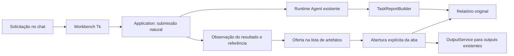

# Agent Workbench técnico — primeira fatia

> Uso local e botao Ativar LLM: [guia atualizado](guides/uso-local-e-llm.md). O Workbench inicia sem gerar chamadas ao modelo.

Avaliação comparativa de desktop, protótipos e medições: [workbench-desktop-evaluation-20261021.md](research/2026/workbench-desktop-evaluation-20261021.md).

Implementação experimental na branch `feat/agent-workbench`. A árvore de trabalho
preserva as correções locais da CLI previamente auditadas. Esta fatia acrescenta
uma interface desktop para o mesmo Agent, com chat e painéis de artefatos.

## Beta desktop WebView2 — F1

O frontend WebView2 agora é um recurso do pacote Python em
`llm_agent.interfaces.workbench.static`; o entry point instalado é
`llm-agent-workbench`. Instale a dependência opcional no Windows:

```powershell
python -m pip install "local-llm-agent[desktop]"
llm-agent-workbench --workspace "D:\meu-projeto"
```

Em desenvolvimento, use `python -m pip install -e ".[dev,desktop]"` e o mesmo
comando. `run_workbench.py` é apenas um atalho para executar o pacote a partir do
checkout. A janela usa WebView2; o Windows precisa ter o [WebView2 Runtime]
instalado. A GUI continua separada do comando padrão `llm-agent` e não inicia
uma sessão de demonstração.

O Workbench lê a configuração e o profile escolhidos pela mesma composição do
CLI. `--home`, `--config` e `--profile` também são aceitos. Um profile carregado
mostra a configuração, mas não é apresentado como conectividade verificada; o
botão **Consultar catálogo** faz uma consulta manual ao catálogo `/models` e não
executa inferência. Mesmo quando o catálogo responde e lista o modelo, isso não
verifica geração.

O chat envia solicitações naturais ao `InteractiveSession` compartilhado, mostra
streaming, solicita cancelamento e aguarda settlement. Relatórios oferecidos pelo
resultado real e outputs existentes podem ser abertos sem perder a conversa.
Após uma falha, cancelamento ou resultado ainda não verificado, **Revisar pedido**
recupera a mensagem para edição, sem reenviar. Se houver outro texto no campo,
ele continua disponível em **Recuperar rascunho**. O atalho respeita o projeto
original e o limite de recuperação; textos maiores são preservados no campo.
Os estados aparecem em português, com erro em vermelho e aviso em âmbar;
status e códigos originais continuam no detalhe do evento e no relatório.
**Arquivos** lista diretórios, abre textos suportados, busca texto e mostra Git
status/diffs por `ReadOnlyWorkspaceQueryService`. **Tarefas** mostra o estado
corrente e as execuções recuperáveis pelo serviço de inspeção; o catálogo de
relatórios históricos não existe nesse serviço e é identificado como ausente.
**Ferramentas** projeta o ToolRegistry e o catálogo de extensões do runtime.

O histórico de **Tarefas** é paginado em grupos de até 50 execuções. Use
**Carregar execuções anteriores** para consultar páginas seguintes. Um registro
ainda retido pode ser aberto pelo seu ID mesmo quando não está na primeira
página; a consulta continua confinada ao workspace da sessão. Atualizar o painel
descarta respostas atrasadas da navegação anterior e IDs repetidos não duplicam
os itens apresentados.

As consultas de arquivos distinguem uma busca sem resultados de uma busca
incompleta: falha de acesso à pasta selecionada retorna erro, enquanto arquivos
ou subpastas inacessíveis preservam os resultados parciais com `truncated=True`.
Um corte no limite de bytes preserva o prefixo UTF-8 completo, sem classificar
um caractere dividido como arquivo inválido. Bytes realmente inválidos continuam
produzindo erro na leitura direta; numa busca de diretório, tornam a cobertura
parcial sem apagar os resultados dos demais arquivos.

A interface inicia em `READ_ONLY`. Os comandos `/modo editor` e `/modo full`
alteram o modo pelo mesmo owner da CLI; autoridade, grants e validação continuam
obrigatórios. Aprovações usam o `ApprovalBroker` compartilhado: o painel mostra
solicitação, recurso e diff disponível, e a decisão é vinculada ao ID, geração e
fingerprint da solicitação. Cancelar ou fechar interrompe a espera de aprovação.

O botão do projeto oferece projetos recentes e um campo para a pasta existente.
Em **Sessão → Perfil e modelo**, escolha entre os perfis configurados. Confira a
seleção e clique em **Aplicar seleção**: o rascunho da conversa permanece no campo.
Os detalhes mostram o comando equivalente. A seleção de perfil atualiza o padrão;
abrir a janela não testa conexão nem geração. [Detalhes e validação](history/2026/changes/selecao-guiada-20261102.md).

A paleta **Comandos** (F2 ou Ctrl+K) é gerada pelo catálogo da CLI, incluindo
aliases e políticas de execução. Ela prepara um rascunho sem executar a seleção.
O compositor aceita os comandos interativos do catálogo: memória, histórico,
instruções, thinking, diagnóstico, modos, código, busca web, inspeção e navegação.
Exemplos: `/system set Responda em português`, `/think 1024`,
`/memory remember projeto descrição`, `/history save`, `/code help`,
`/workspace switch "D:\outro projeto"`, `/model select PERFIL` e `/inspect list`.
Argumentos que a CLI solicita por prompt são escritos após o comando no app.

Trocas de workspace e perfil exigem uma sessão ociosa e fecham o runtime anterior.
A troca de workspace exige resolver mensagens pendentes e invalida as referências
visuais anteriores. O workspace novo também começa em READ_ONLY. Durante uma
tarefa, os controles locais continuam disponíveis; texto comum pode entrar na
fila limitada. Em **Tarefas → Fila de pedidos**, confira a mensagem e use
**Enviar** quando a sessão estiver livre, ou **Remover** para descartá-la.
Essas ações preservam o texto que já está no campo de mensagem. O envio é sempre
explícito, e `/pending send ID` continua disponível. `/pending edit ID` recupera
o rascunho sem consumi-lo. Não há armazenamento paralelo de execuções.

A cobertura compartilhada é do catálogo **interativo** da CLI. Instalação,
empacotamento e opções administrativas headless continuam nos entry points
existentes. O app oferece `/exec` para um comando pontual escrito pela pessoa e,
no modo local, comandos podem ser enviados sem ativar a LLM. Cada envio cria um
processo novo no workspace atual; não mantém TTY, variáveis ou diretório entre
comandos e não oferece sandbox. A confirmação nativa mostra o comando antes da
execução. O modelo nunca recebe essa capacidade de shell genérico. Não foi feita
inferência contra um modelo real nesta revisão.

## Protótipo Tk anterior

As seções seguintes documentam a primeira fatia Tk; as capacidades atuais do
app WebView2 estão descritas acima.

### Executar

Com Python com Tk disponível e a configuração existente inicializada:

```powershell
$env:PYTHONPATH = (Resolve-Path .\src).Path
.venv\Scripts\python.exe -m llm_agent.interfaces.workbench --workspace "D:\meu-projeto"
```

O exemplo executa o código da branch. Com o pacote instalado em outro ambiente, o ajuste de `PYTHONPATH` é dispensável.

Também aceita `--home`, `--config` e `--profile`. O workspace é obrigatório.
Use a configuração e o perfil que já funcionam na CLI. O Workbench não inicializa
automaticamente uma configuração ausente: a falha aparece na conversa na primeira
operação. Tk acompanha a instalação Windows usada nesta implementação; outras
distribuições Python podem precisar instalar o pacote de Tk do sistema.

Escreva uma solicitação como “Analise notes.txt e descreva os problemas encontrados”.
Envie com o botão ou Ctrl+Enter. A admissão natural existente decide se responde,
pede esclarecimento ou inicia uma tarefa. Quando a aplicação fornece um relatório,
ele aparece na lista abaixo da conversa. Selecione-o e use “Abrir selecionado ao
lado”. Arraste o divisor para redimensionar os painéis. Cada aba pode ser fechada;
o item da lista permite reabri-la. A conversa continua disponível.

“Artefatos” consulta os outputs retidos no workspace. “Ferramentas” abre uma
projeção do registro de ferramentas do runtime e das extensões configuradas. O
painel informa que a execução permanece sujeita à autoridade e ao modo da sessão.

## Investigação e fontes reutilizadas

| Mecanismo existente | Papel no Workbench |
| --- | --- |
| `extensions/extension_manifest_parser.py` | Contrato fechado de plugins de execução via stdio; não recebe campos de GUI. |
| `extension_catalog_service.py` e `workspace_extensions_service.py` | Catálogo, seleção, grants e resolução existentes; a GUI consulta, sem cadastrar ou ativar extensões pelo painel. |
| `agent/tools/tool_registry.py` | Descritores realmente publicados pelo runtime, incluindo sua origem. A interface recebe uma projeção pela camada application. |
| `agent/reporting/task_report.py` | Produz e persiste os relatórios JSON/Markdown. O Workbench lê o caminho oferecido pela aplicação, sem gerar outro relatório. |
| `agent/reporting/run_snapshot.py` | Snapshot canônico terminal, usado pela projeção de resultado para informar run id e completude final. |
| `application/workbench/submission.py` | Projeta run id e completude do snapshot canônico para a interface, preservando a projeção histórica da CLI. |
| `application/task_execution.py` | Inicialização, submissão natural, observação, cancelamento e encerramento do mesmo runtime utilizado pela CLI. |
| `outputs/models.py`, `service.py` e `store.py` | Identidade, origem, digest, truncamento, limites e leitura dos outputs existentes. Nenhuma republicação é necessária para abrir uma aba. |
| `agent/reporting/public_projection.py` e projeções de progresso | Owners existentes de fatos operacionais. A GUI não recalcula sucesso nem satisfação do objetivo. |

## Fronteiras da implementação



`application/workbench/` contém contratos de apresentação, referências transitórias,
leitura sob demanda e a projeção do inventário. `interfaces/workbench/` contém a
sessão de trabalho e os widgets. A GUI não importa o pacote `agent` nem a CLI;
o acesso aos owners fica na camada application.

A chave de uma aba é `(workspace_id, run_id, artifact_id)`. `run_id=None` significa
que a fonte não informou a execução; nenhum identificador substituto é inventado.
Outputs usam seu `output_id` existente. Relatórios usam a identidade do caminho
fornecido pelo resultado, preservada junto ao run id. O inventário é explicitamente
uma projeção transitória de runtime, sem run id ou arquivo de artefato persistido.

As referências não contêm o payload. A seleção abre uma aba e solicita a leitura
na thread de trabalho. Abrir novamente a mesma identidade seleciona a aba existente.
Fechar destrói seus widgets e libera o conteúdo visual. Falhas de leitura aparecem
na própria aba, preservando a referência e a conversa.

## Execução e contribuição visual

Plugins de execução continuam sujeitos aos manifests, bootstrap, transporte,
capabilities e grants existentes. Contribuições visuais descrevem somente uma
associação entre um tipo já conhecido de artefato e um renderizador nativo.

Exemplo do contrato declarativo fechado:

```json
{"kind": "diff", "renderer": "diff"}
```

`parse_visual_contribution` rejeita campos adicionais, tipos desconhecidos e
renderizadores fora de `text`, `json` e `diff`. A composição nativa usa o mesmo
contrato. Esta fatia não descobre arquivos de contribuição em extensões nem altera
os manifests de execução. Uma futura integração deverá receber dados declarativos
validados pela aplicação; ela não deverá carregar módulos, callbacks ou entrypoints
de extensões na interface.

Os renderizadores exibem texto original, validam JSON para apresentação e destacam
linhas de diff. Markdown é mostrado como texto legível. Não há execução de HTML,
JavaScript, scripts, links, comandos ou código encontrado no conteúdo. Tabelas,
buscas, logs, testes e arquivos usam o texto já publicado pelo produtor.

## Parcial, final e proveniência

`PanelReference.completeness` aceita `partial`, `final` e `unknown`. A projeção do
resultado só declara relatório final quando recebe o snapshot canônico terminal.
Um relatório final pode documentar falha, bloqueio ou cancelamento; completude não
é sucesso. Sem essa evidência, o campo fica desconhecido, mesmo que uma resposta
contenha a palavra “concluído”. Referências explicitamente parciais continuam
parciais. Outputs truncados na fonte indicam conteúdo parcial; outputs sem metadados
de ciclo de vida permanecem com completude desconhecida.

Esta fatia oferece o relatório após o settlement. Não transforma o tracker de
progresso em um relatório final e não simula relatórios incrementais. O contrato
permite apresentar parciais quando um produtor existente os fornecer explicitamente.

O painel mostra workspace, execução, origem, identidade do artefato e completude.
Outputs mantêm o digest original validado pelo store. Relatórios pequenos recebem
o SHA-256 dos bytes efetivamente lidos. Prévias limitadas não recebem um digest
que possa ser confundido com o do arquivo inteiro. O viewer rejeita caminhos de
relatório com componentes link/reparse; ele aceita somente referências oferecidas
na sessão e nunca transforma caminhos citados pelo modelo em ofertas de arquivos.

## Recursos e limites desta fatia

- Tk nativo, sem navegador embutido, servidor HTTP ou dependência gráfica nova.
- Um executor com uma thread; uma operação em andamento por sessão. Leitura de
  artefatos e execução usam essa fila, evitando concorrência com owners do Agent.
  Abas já carregadas continuam consultáveis durante outra execução.
- Até 12 abas abertas, 128 itens na lista visual e 256 referências transitórias.
- Relatórios: prévia máxima de 256 KiB. Outputs: trechos de 16.384 caracteres pelo
  serviço existente, com botão para o próximo trecho. O painel substitui o trecho
  anterior, mantendo limitado o conteúdo carregado.
- Conversa visual limitada por tamanho de mensagem e buffer; isso não reescreve
  o histórico canônico. Entrada limitada a 16.000 caracteres por solicitação.
- Sessão inicial READ_ONLY pelo startup interativo existente. Aprovações nesta
  fatia retornam UNAVAILABLE; a GUI não concede aprovação automaticamente.
- Cancelar registra um pedido; a janela aguarda o resultado real. Fechar solicita
  cancelamento e aguarda a liberação do runtime na mesma thread.

Histórico visual entre reinicializações, streaming de tokens, aprovação interativa,
edição/aplicação de diffs, preview rico de Markdown e painéis especializados de
métricas ficam para fatias posteriores. Não há decisão de aceitação W23 ou de
satisfação semântica na apresentação.

## Validação

Os testes em `tests/integration/test_workbench_vertical_slice.py` substituem somente
o gateway de modelo por uma fixture offline já existente. Eles executam a admissão
natural, o Agent, `file_reader`, o reporting e a leitura do arquivo persistido. O
teste de widgets Tk envia a solicitação pela janela, abre, fecha e reabre a aba e
confere que a conversa foi preservada. Em ambientes sem display, apenas esse teste
de widgets é ignorado explicitamente.

Os testes unitários cobrem ausência de relatório, origem e identidade, conteúdo
exato, leitura sob demanda, limites, truncamento, isolamento entre referências,
reutilização de outputs e rejeição de contribuições executáveis. Não houve chamada
a endpoint real de modelo. Os resultados dos gates desta rodada são registrados
em [workbench-validation-20261021.md](history/2026/milestones/workbench-validation-20261021.md).

A composição WebView2 é coberta por `tests/integration/test_workbench_webview_beta.py`;
os testes de protocolo e frontend em `prototypes/workbench-comparison` apontam
para o bridge e os assets empacotados. Eles usam gateways sintéticos e não fazem
inferência real.

[WebView2 Runtime]: https://pywebview.flowrl.com/guide/installation

O relatório específico da beta desktop F1, incluindo regressão, empacotamento e
limitações dos gates globais, está em [workbench-desktop-f1-20261022.md](history/2026/milestones/workbench-desktop-f1-20261022.md).
O diagnóstico e fechamento incremental de W21, CURRENT e Ruff está em
[workbench-f1-gate-closure-20261022.md](history/2026/milestones/workbench-f1-gate-closure-20261022.md).

## Revisão de compartilhamento — 29/10/2026

`interactive/local_commands.py` concentra operações locais consumidas pela CLI e
pelo app; `worker_operations.py` compartilha código e busca web tipados.
`session_controls.py` compartilha controles e o vínculo do broker de aprovação.
A sessão gráfica mantém um worker e filas, transporte, referências e histórico
visual limitados. Esta revisão não acrescenta dependências nem um backend
persistente. `test_workbench_command_parity.py` cobre os IDs do catálogo,
operações locais no runtime real sem inferência, cancelamento de aprovações,
identidades obsoletas e consumo de mensagens pendentes. A validação visual
nativa e o teste com um endpoint real continuam separados da regressão offline.

Validação desta revisão: 214 testes Python aprovados; dois testes que procuram
Node no PATH foram ignorados pelo pytest, e ambos os harnesses foram executados
com sucesso pelo Node REPL. Mypy passou em 962 arquivos, Ruff e complexidade
passaram nos módulos envolvidos, e CURRENT passou com 962 módulos e 3.391 arestas.
O wheel foi importado em modo isolado e expôs as 46 ações do catálogo. Na revisão
registrada, o launcher antigo `Abrir Workbench.cmd` ainda apontava para o bundle
de 22/10; a entrada atual foi consolidada em `Workbench.cmd`.

## Plugins locais

Em **Mais recursos → Plugins**, registre um manifest local, habilite a extension neste projeto, conceda suas capacidades e autorize os IDs que deseja usar na sessão. Os detalhes mostram origem, fingerprints e diagnósticos. Atualização do manifest e remoção de registro são explícitas e preservam os arquivos do plugin. Seu rascunho permanece no composer. [Guia e limites de segurança](plugins-locais.md).


## Baterias de testes

O painel Testes usa o mesmo agendador, servico e runtime da CLI. Consulte [o guia da fila](guides/fila-de-testes.md) e [a entrega da integracao](history/2026/changes/workbench-baterias-20261102.md).
