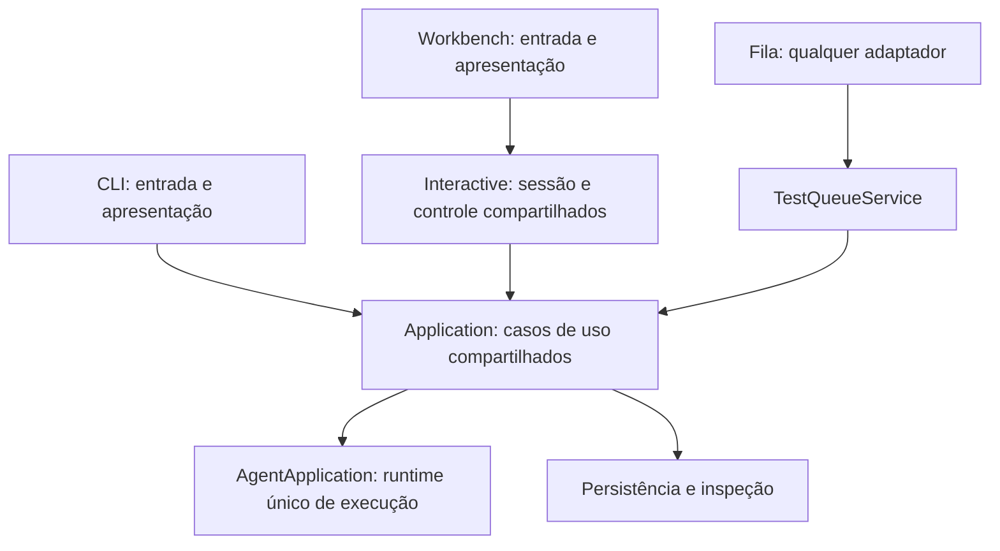

# Núcleo compartilhado — verificação de 02/11/2026

Os artefatos locais citados neste documento não são versionados nem publicados com o repositório. Seus caminhos são referências da investigação original e não comprovam a validação do candidato atual.

Atualizacao posterior nesta data: o [painel Testes no Workbench](../changes/workbench-baterias-20261102.md) foi entregue. As observacoes anteriores sobre ausencia do painel representam o estado historico desta avaliacao.

App e CLI devem captar entrada, encaminhar ações aos casos de uso e apresentar observações. Configuração efetiva, autorização, execução, persistência, validação e classificação de resultados pertencem às camadas compartilhadas.

## Caminhos verificados

- CLI: `interfaces/cli/bootstrap.py` cria os parâmetros de entrada e chama `application/task_execution.py`.
- Workbench: `interfaces/workbench/_webview_host.py` cria uma `interactive/session.py`, que usa a mesma API de execução.
- A criação efetiva do runtime permanece em `AgentApplication.create`, por trás dos casos de uso de Application.
- O controlador exportado pela CLI é o mesmo `InteractiveExecutionController` do pacote `interactive`. Aprovação, envelopes e operações compartilhadas também são reutilizados.
- O worker interativo usa `application/interactive_worker.py`; a interface publica texto, enquanto os casos de uso executam as operações.
- Entrada por terminal, atalhos, diálogos, renderização, correlação das respostas da bridge e ciclo da janela continuam como responsabilidades dos adaptadores.

CLI e Workbench compartilham a implementação e os contratos. Cada abertura pode ter seu próprio contexto, workspace e home. A arquitetura atual usa uma biblioteca compartilhada; não foi acrescentado um servidor central para duas interfaces controlarem a mesma sessão simultaneamente.

## Desvios encontrados e corrigidos

A CLI da fila ainda preparava configuração, construía o executor e decidia a classificação final. Isso foi movido para `application/test_queue_service.py`.

`TestQueueService` oferece importação, inspeção, conferência, execução, priorização, controles, detalhes e exportação. `QueueExecutionRequest` expressa as opções de execução. `QueueRunResult` fornece observação e avaliação neutra, sem código de saída de terminal. A CLI converte essa avaliação em códigos de saída e apresenta os dados.

A autorização para chamadas reais passou a ser exigida no serviço compartilhado, antes de carregar configuração ou produzir efeitos. Isso evita depender exclusivamente da validação de argumentos da CLI. Os limites e os tipos das permissões também são validados nesse ponto.

A persistência do último projeto estava implementada em `interfaces/cli/workspace_entry.py`. Agora pertence a `application/workspace_preferences.py`, que reutiliza o histórico compartilhado de projetos recentes. Os nomes antigos da CLI reexportam exatamente as funções da aplicação, preservando seus consumidores.

A fila ainda é exposta pelo menu/CLI. O backend agora tem uma fachada compartilhada para a futura interface no Workbench, sem necessidade de copiar sua lógica para a bridge ou para JavaScript.

## Proteções e validação

- 96 testes direcionados passaram na primeira validação, cobrindo fila, serviço e seleção de projeto.
- A regressão passou em 745 testes, com 14 ignorados.
- Os 19 testes do serviço/proteção arquitetural passaram após o reforço das guardas.
- A prova de importação em processo isolado bloqueia imports de interfaces e bibliotecas de UI e carrega os serviços compartilhados.
- Os testes verificam autorização antes de configuração/efeitos, classificação neutra e identidade das funções de persistência reexportadas pela CLI.
- Uma guarda AST impede a composição direta do runtime da fila nas interfaces; só o evento de progresso é consumido diretamente como contrato de apresentação.
- Arquitetura: PASS, 995 módulos e 3518 relações. Regras e baselines não foram relaxadas.
- Ruff passou; mypy passou nos quatro arquivos de produção alterados.
- Nenhuma inferência real foi realizada.

As verificações cobrem os caminhos citados e o grafo arquitetural do projeto. Evidências: regressão (artefato local: `reports/shared-core-20261102/regression.xml`) e testes direcionados (artefato local: `reports/shared-core-20261102/tests.xml`).
